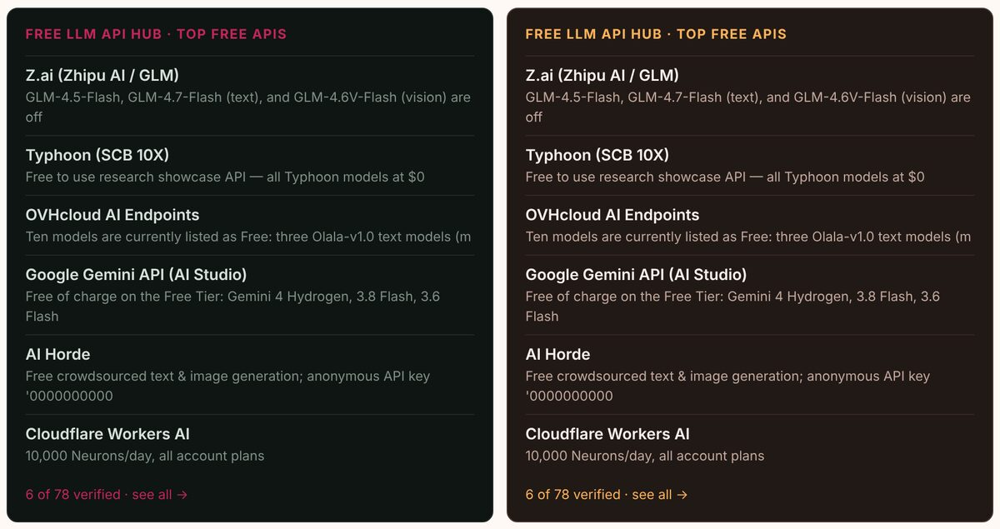
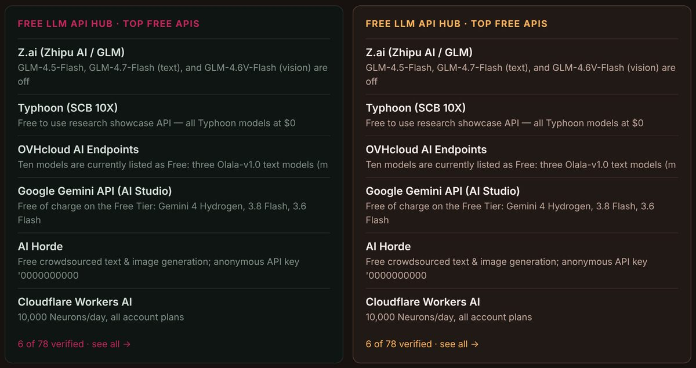

# Post-brand QA — November 2026

QA pass on the live site after the Cálida brand (#844–#847) shipped. Run on 2026-11-26 against
`https://freellmapihub.com` once the home page showed the tagline "We read the docs. You ship the code."
(main at `2b18bd7`).

## Scope and method

- **Pages, each at 1440 px and 375 px, in light and dark** (`prefers-color-scheme`, which the inline head script turns
  into `data-theme`): home; `/p/` for Groq, Google Gemini, OpenRouter, Cloudflare Workers AI and AI21; `/models/` and one
  model page; `/compare/` and one pair; `/changes/`; `/api/`; `/find/`; `/not-free/`; `/embed/`;
  `/guides-and-collections/`, one guide and one collection; `/state/2026-11/`; `/best/`; the 404. A second run covered
  `/best/methodology/`, `/coverage/`, `/quality/`, `/submit/`, `/methodology/`, `/contributing/`, `/data-policy/`,
  `/agreements/`, `/free-gpu/`, `/coding-tools/` and one tool, `/programs/` and one program, `/updates`, and the legal pages.
  That is 37 pages, 148 renders.
- **Per render** (Playwright and Chromium): console errors and warnings, uncaught exceptions, failed requests and
  responses with status 400 or above, horizontal overflow (`scrollWidth` against `clientWidth`, plus the elements that
  stick out), axe-core 4 with the WCAG 2.0/2.1 A and AA rules (contrast included), and the first 25 Tab stops, each
  checked for a visible outline or box-shadow.
- **Links and social images:** every page in `sitemap.xml` and `sitemap-state.xml`, plus `/changes/` and `/404.html`
  (199 pages). Each internal `href`/`src` was requested (823 unique targets). For every `og:image`, the check reads the
  status, the type and the PNG size.
- **Lighthouse 13** (mobile and desktop presets) on the home page and `/p/groq`.

## Results

| Check | Result |
| --- | --- |
| HTTP status | 36 pages 200; the 404 page returns 404 with its own page |
| Console errors / exceptions | None. The 404 logs the expected "Failed to load resource: 404" for its own URL |
| Failed requests | None (the sandbox's proxy blocks the Cloudflare analytics beacon; that is not counted) |
| Horizontal overflow at 375 px | None (`scrollWidth` = 375 on every page, both themes) |
| Focus visibility | 25 of 25 Tab stops show a ring on every render |
| Broken internal links | 0 of 823 targets across 199 pages |
| OG images | 114 distinct, all 200 `image/png` at 1200×630; every page has an `og:image` |
| axe WCAG AA | **`/embed/`: color-contrast, 2 nodes, both themes (regression, fixed)**; `link-in-text-block` on compare pair pages and guide tables (from before the brand, see below) |
| Lighthouse, home | Performance 100 · Accessibility 100 · Best practices 96\* · SEO 100 (mobile and desktop) |
| Lighthouse, `/p/groq` | Performance 100 · Accessibility 100 · Best practices 96\* · SEO 100 (mobile and desktop) |

\* The only failing best-practices audit is `errors-in-console`, from the sandbox proxy refusing
`static.cloudflareinsights.com`. It does not happen on a normal connection.

Mobile LCP is 1.2 s (home) and 1.4 s (`/p/groq`). CLS is 0 and TBT at most 10 ms.

## Regression fixed

**The embed widget kept the pre-Cálida panel with the interim crimson accent.** `site/widget.js` inlines its colours
(it runs on other people's sites), so the palette change in `styles.css` never reached it. The brand PRs changed only
the accent: green `#3fce8f` became crimson `#c2255c`, still on the old green-black panel `#0f1512`. The heading and the
"see all" link read at **3.27:1**, below the 4.5:1 that WCAG AA asks for. On the light theme the green-black box also
clashed with the warm page.

| Element | Before | After |
| --- | --- | --- |
| Panel | `#0f1512` | `#211915` (`--panel`) |
| Border / row rules | `#232c25` / `#1d2a22` | `#4a3830` (`--border-strong`) / `#352822` (`--border`) |
| Heading and "see all" link | `#c2255c`, 3.27:1 | `#ffb25c` (`--accent`), 9.69:1 |
| Provider name | `#d8e2dc` | `#fbf1ec` (`--text`), 15.56:1 |
| Free-tier line | `#808f87`, 5.45:1 | `#c2a89e` (`--muted`), 7.73:1 |
| axe color-contrast on `/embed/` | 2 violations per render | 0 |

Light theme, before (left) and after (right):

Dark theme, before (left) and after (right):

A new test in `scripts/widget.test.mjs` takes the dark tokens from `:root` in `site/styles.css`, fails if the widget
uses any other hex colour, and checks every text colour is at least 4.5:1 on the panel. It fails on the old widget and
passes on the new one.

## Found, from before the brand (not fixed here)

A build of `2a36069`, the commit before #844, shows both of these too:

- **`link-in-text-block`** on `/compare/<a>-vs-<b>` (`.cmp-sub` "#N in the top 10" link) and on the guide tables
  (links in the "Commercial use" cells). They are not underlined, and their colour differs from the text around them by
  2.88:1 (light) and 1.6:1 (dark). WCAG 1.4.1 asks for 3:1 or a non-colour cue. Desktop only: on mobile the tables turn
  into cards. The fix is to underline them, like `.prov-score a` and `.req-source a`.
- **`/models/` at 375 px:** the four-column table squeezes "Free type" and "Modalities", so words break mid-word
  ("rene / wing", "embeddin / gs"). The page does not overflow, but it reads badly.
  **Fixed since:** under 560px each row is now a card with its column names as labels, and wider tables wrap words
  only at spaces ([375 px](models-index-mobile/models-375.jpg), [desktop](models-index-mobile/models-desktop.jpg)).

Also seen: `assets/demo.svg` (README) still uses the old green palette, and the `var()` fallbacks in
`scripts/lib/consent.client.js` still hold the old hexes. The fallbacks never render, because the tokens are always
defined.

## Local pipeline

Run on Node 24.22.3, on a full clone (the build mines `git log`, so a shallow clone fails the history tests):

| Command | Result |
| --- | --- |
| `npm ci` | OK |
| `npm run build` | OK: 79 providers, 79 provider pages, 30 compare pages |
| `npm test` | 1315 / 1315 pass (after `node scripts/check-og.mjs \|\| node scripts/og.mjs`, as `verify.yml` does in push mode) |
| `npm run check` | Fails on generated-file drift only: the committed `site/**` lags the data, which the regeneration bot fixes on main in push mode. Same result on unmodified main |
